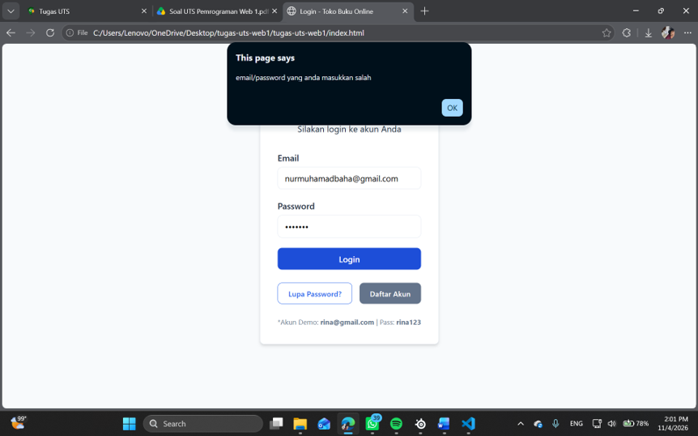
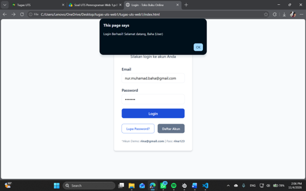
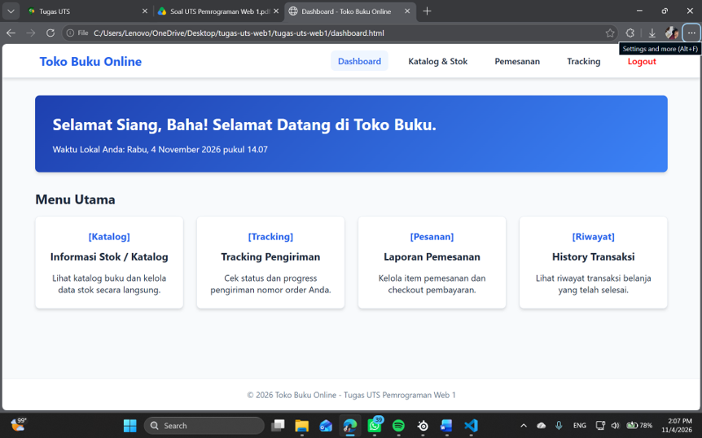
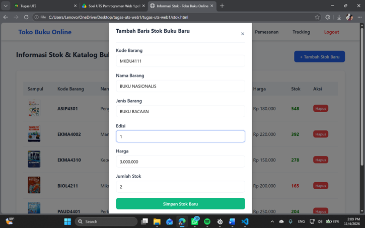
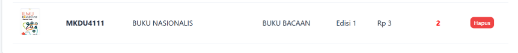
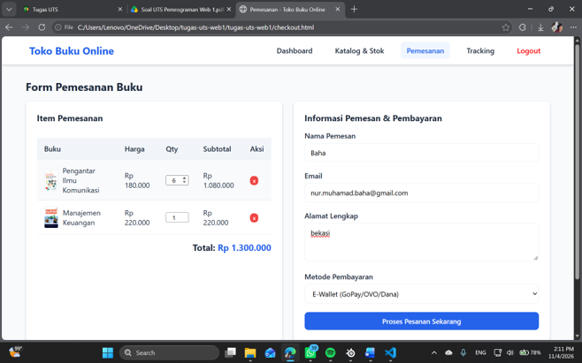
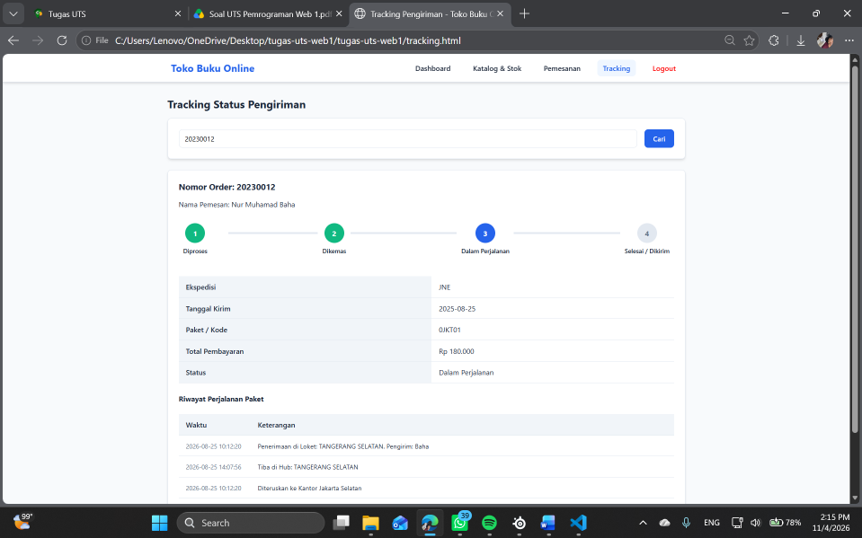

# UJIAN TENGAH SEMESTER

## PEMROGRAMAN WEB

### Identitas

* **Dosen Pengampu:** Agung Nugroho, S.Kom., M.Kom.
* **Nama:** Nur Muhammad Baha Uddin Naqsabandi
* **NIM:** 312510264
* **Program Studi:** Teknik Informatika
* **Fakultas:** Teknik
* **Universitas:** Universitas Pelita Bangsa
* **Tahun:** 2026

---

## Deskripsi Project

Project ini merupakan aplikasi frontend **Toko Buku Online** yang dibuat menggunakan HTML, CSS, dan JavaScript. Aplikasi ini digunakan untuk melakukan simulasi login, melihat dashboard, mengelola informasi stok dan katalog buku, melakukan pemesanan, serta melihat informasi pengiriman.

Data pengguna, katalog buku, dan informasi pengiriman disimpan pada file `js/data.js`. Logika interaksi halaman dan manipulasi DOM terdapat pada file `js/script.js`.

---

## Struktur File Project

```text
tugas-uts-web1/
├── index.html              # Halaman login
├── dashboard.html          # Halaman dashboard
├── stok.html               # Informasi stok dan katalog buku
├── checkout.html           # Halaman pemesanan
├── tracking.html           # Informasi pengiriman
├── css/
│   └── style.css           # Pengaturan tampilan halaman
├── js/
│   ├── data.js             # Data pengguna, buku, dan pengiriman
│   └── script.js           # Logika aplikasi dan manipulasi DOM
├── img/                    # Gambar sampul buku
├── screenshots/            # Folder penyimpanan foto dokumentasi
└── README.md               # Dokumentasi project
```

---

## Hasil Pelaksanaan

### 1. Halaman Login

Pada halaman login terdapat kolom penginputan email dan password serta tombol **Login**. Data yang dimasukkan akan divalidasi dengan data pengguna yang terdapat pada file `js/data.js`.

Jika email dan password sesuai, pengguna diarahkan ke halaman dashboard. Jika data tidak sesuai, sistem menampilkan pemberitahuan berupa popup bahwa email atau password salah.

* **Foto 3 - Login Berhasil:**



* **Foto 4 - Login Gagal:**



*Keterangan:* Foto 1 menunjukkan login dengan data yang benar, sedangkan Foto 2 menunjukkan pemberitahuan popup ketika email atau password tidak sesuai.

---

### 2. Halaman Dashboard

Halaman dashboard merupakan halaman utama setelah pengguna berhasil login. Dashboard menampilkan sapaan berdasarkan waktu lokal pengguna dan beberapa menu utama aplikasi.

Menu yang tersedia:

- Informasi Stok/Katalog.
- Pemesanan.
- Informasi Pengiriman.
- Riwayat transaksi.

* **Foto 5 - Halaman Dashboard:**




*Keterangan:* Dashboard digunakan sebagai pusat navigasi menuju fitur-fitur utama toko buku online dan menampilkan riwayat transaksi pengguna.

---

### 3. Informasi Stok/Katalog

Halaman Informasi Stok/Katalog menampilkan daftar buku yang tersedia. Informasi yang ditampilkan meliputi sampul, kode barang, nama barang, jenis barang, edisi, harga, dan jumlah stok.

Fitur yang tersedia:

- Melihat katalog buku.
- Melihat jumlah stok setiap buku.
- Menambahkan stok buku baru.
- Menghapus data stok buku.

* **Foto 6 - Informasi Stok/Katalog:**



* **Foto 7 - Form Tambah Stok:**



*Keterangan:* Foto 6 menampilkan data katalog dan stok buku, sedangkan Foto 7 menampilkan form untuk menambahkan stok buku baru. Data katalog dirender secara dinamis menggunakan JavaScript.

---

### 4. Pemesanan

Halaman Pemesanan digunakan untuk mengatur buku yang akan dibeli dan mengisi informasi pemesan.

Fitur yang tersedia:

- Melihat item pemesanan.
- Mengubah jumlah buku.
- Menghapus item dari pesanan.
- Menghitung subtotal dan total pembayaran.
- Mengisi nama, email, alamat, dan metode pembayaran.

* **Foto 6 - Halaman Pemesanan:**



*Keterangan:* Proses pemesanan dan pembayaran pada project ini masih berupa simulasi frontend.

---

### 5. Informasi Pengiriman

Halaman Informasi Pengiriman digunakan untuk mencari status pengiriman berdasarkan nomor Delivery Order (DO).

Nomor DO yang dapat digunakan:

| Nomor DO | Pemesan | Status |
|---|---|---|
| `20230012` | Nur Muhamad Baha | Dalam Perjalanan |
| `20230013` | Agus Pranoto | Dikirim |

Informasi yang ditampilkan meliputi nomor order, nama pemesan, ekspedisi, tanggal kirim, kode paket, total pembayaran, status, dan riwayat perjalanan paket.

* **Foto 7 - Informasi Pengiriman:**



*Keterangan:* Masukkan nomor DO yang tersedia untuk menampilkan detail dan status pengiriman.

---

## Akun Demo

| Nama | Email | Password | Role |
|---|---|---|---|
| Baha | `nur.muhamad.baha@gmail.com` | `Baha123` | User |
| Agus Pranoto | `agus@gmail.com` | `agus123` | User |
| Siti Marlina | `siti@gmail.com` | `siti123` | Admin |

---

## Cara Menjalankan Project

1. Buka folder project menggunakan Visual Studio Code.
2. Buka file `index.html` menggunakan browser.
3. Gunakan ekstensi **Live Server** agar project dapat dijalankan dengan lebih optimal.
4. Login menggunakan salah satu akun demo.
5. Buka setiap menu untuk mencoba fitur aplikasi.

Project ini tidak memerlukan instalasi package atau server backend.

---

## Urutan Foto Dokumentasi

Simpan foto screenshot pada folder `screenshots` menggunakan nama berikut:

```text
screenshots/
├── foto-3.png  # Poin 1
├── foto-4.png  # Poin 2
├── foto-5.png  # Poin 3
├── foto-6.png  # Poin 4
└── foto-7.png  # Poin 5
```

Urutan dokumentasi dimulai dari poin 1 menggunakan `foto-3.png` hingga poin 5 menggunakan `foto-7.png`.

---

## Catatan

- Project ini masih berupa simulasi aplikasi frontend.
- Data aplikasi berada pada file `js/data.js`.
- Project belum menggunakan database, autentikasi server, atau payment gateway nyata.
- Data yang ditambahkan pada halaman hanya berlaku selama sesi browser digunakan.
